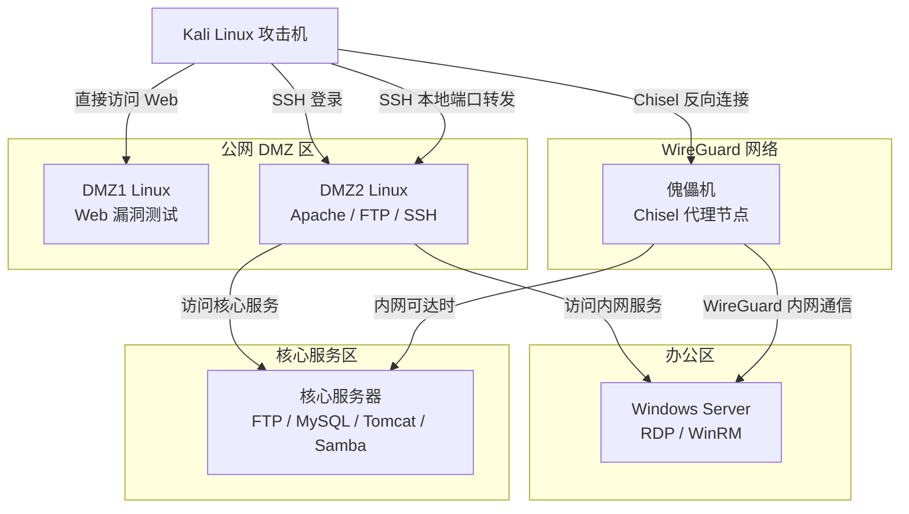

# 虚拟企业网络红蓝对抗综合演练复盘

> 项目时间：2026.06  
> 项目类型：团队课程项目  
> 项目角色：红队攻击与安全测试  
> 实验环境：基于 WireGuard 的虚拟企业分区网络

## 1. 项目概述

本次项目是一次基于自建虚拟企业网络环境的红蓝对抗课程演练，模拟企业网络中公网 DMZ 区、办公区和核心服务区之间的网络关系。

红队从公网暴露的 Linux 服务器入手，通过信息收集、Web 漏洞验证和主机服务测试获取初始访问能力，再利用网络隧道和跳板访问隔离网络中的 Windows 主机及核心服务，开展远程管理、权限检查和提权测试。

项目主要涉及以下内容：

- Web 应用漏洞发现与验证；
- Linux 主机服务配置风险识别；
- SSH 跳板、端口转发及 SOCKS5 代理；
- Windows 远程管理与权限安全检查；
- PrintNightmare 提权与凭证安全测试；
- 红蓝对抗过程中的攻击检测与结果分析。

本文根据个人操作记录、历史截图、课程实验报告及团队资料整理。对于部分由团队成员完成的实验，保留其技术过程作为项目整体背景，但在个人贡献和结果描述中区分实际操作与团队记录。

---

## 2. 实验环境与网络结构

### 2.1 主要节点

| 节点 | 作用 | 主要服务或技术 |
|---|---|---|
| Kali Linux | 红队攻击机 | Nmap、Burp Suite、Hydra 等 |
| DMZ1 | 公网 Linux 服务器 | Web 应用、HTTP/HTTPS |
| DMZ2 | 公网 Linux 跳板机 | Apache、FTP、SSH |
| WireGuard 傀儡机 | 内网代理中间节点 | Chisel、SOCKS5 |
| Windows Server | 办公区目标主机 | RDP、WinRM |
| 核心服务器 | 核心业务服务 | FTP、MySQL、Tomcat、Samba |
| WireGuard | 内网通信网络 | 隔离网段互通 |

### 2.2 网络拓扑

本次实验涉及两种不同的内网访问路径，因此将它们分别表示。



**两条内网访问路径：**

1. SSH 本地端口转发：Kali 通过 SSH 登录 DMZ2，由 DMZ2 访问其能够连通的内网目标，将指定服务映射到 Kali 本地。
2. Chisel + Proxychains：利用 WireGuard 网络中的傀儡机建立反向 SOCKS5 代理，Kali 通过 Proxychains 将支持代理的工具流量转发至内网。

两种方式都能实现跨网段访问，但适用条件和连接组织方式不同，具体在第 5.3 节分析。

### 2.3 实验目标

1. 对公网暴露服务进行信息收集与攻击面识别。
2. 验证 DMZ 区 Web 漏洞和 Linux 服务配置风险。
3. 分析如何利用跳板和代理访问隔离网络。
4. 对 Windows 远程管理、账户权限和系统配置开展安全测试。
5. 验证提权风险，记录攻击行为及蓝队检测情况。
6. 整理测试证据、风险结论和修复建议。

---

## 3. 个人参与内容

本次项目为团队协作完成，我主要参与和整理的工作包括：

**DMZ1 Web 安全测试**
- 文件上传与 WebShell 验证。
- Struts2 S2-045 远程命令执行。
- SQL 注入与数据库信息枚举。
- 任意文件读取、命令注入及信息泄露。

**DMZ2 Linux 服务测试**
- Nmap 端口与服务识别。
- Gobuster 目录枚举。
- Apache 目录索引及备份文件泄露。
- FTP 匿名访问。
- SSH 弱口令验证与普通用户登录。

**Windows 与内网访问**
- Chisel SOCKS5 代理与 Proxychains 流量转发。
- Windows RDP、WinRM 远程访问验证。
- Windows 账户、用户组和权限检查。
- AlwaysInstallElevated、Print Spooler 等风险点检查。
- PrintNightmare 提权与 Mimikatz 凭证安全实验。

**项目整理**
- 整理攻击过程和历史操作记录。
- 分析不同网络转发方式的原理与适用场景。
- 形成内网渗透 SOP v1.0。
- 整理攻击链复盘和安全修复建议。

---

## 4. 攻击链概览

### 4.1 DMZ1：Web 漏洞测试

Kali 直接访问 DMZ1 的公网 Web 服务，通过端口扫描、目录枚举和接口分析识别攻击面。

主要验证内容：

- 文件上传与 WebShell。
- Struts2 S2-045。
- SQL 注入。
- 任意文件读取。
- 命令注入。
- HTTPS 信息泄露及后台路径识别。

### 4.2 DMZ2：Linux 服务风险与初始访问

通过服务扫描和目录枚举，发现 Apache 目录索引、备份文件暴露、FTP 匿名访问及 SSH 弱口令等问题。

成功登录普通用户 `mumu` 后，进一步收集系统信息并分析 DMZ2 与 WireGuard 内网之间的连通关系。

### 4.3 Windows：内网访问与权限验证

利用 Chisel 和 Proxychains 建立代理通道，或通过 DMZ2 的 SSH 本地端口转发访问内网 Windows 服务。

主要验证：

- RDP 远程桌面访问。
- WinRM 远程 PowerShell 会话。
- Windows 用户及管理员组权限。
- 系统安装策略与服务配置。
- PrintNightmare 提权。
- LSASS 凭证暴露风险。

### 4.4 核心区：内部服务安全测试

团队实验资料还包括核心服务器的 FTP、MySQL、Tomcat 和 Samba 服务测试，主要用于了解内部业务服务暴露、身份认证和访问控制风险。

---

## 5. 关键技术复盘

## 5.1 DMZ1：Web 漏洞测试

### 5.1.1 文件上传与 WebShell

**测试结果：已验证**

在文件上传场景中，通过构造上传请求验证服务端对文件类型和上传内容的处理方式，确认上传内容能够被服务端解释执行。

随后结合 Weevely 建立 WebShell 会话，对目标环境进行简单命令执行验证。

**技术要点：**

- 文件上传成功不等于命令执行成功。
- 需要判断上传文件是否能够被服务端访问和执行。
- WebShell 本质上是通过服务端脚本执行能力实现远程命令交互。
- 应区分普通文件上传、服务端代码执行和交互式 Shell。

**风险与修复：**

- 限制允许上传的文件类型。
- 上传目录与脚本执行目录分离。
- 禁止上传目录执行脚本。
- 对文件名、扩展名、MIME 类型和文件内容进行联合校验。

### 5.1.2 Struts2 S2-045（8443）

**测试结果：已验证**

使用 Burp Suite 构造恶意 HTTP Content-Type 请求，验证 Struts2 组件的 OGNL 表达式注入问题。

通过命令执行结果返回，确认目标能够执行系统命令。历史记录中包含 `id`、`whoami` 和目录信息等验证结果。

**漏洞原理：**

S2-045 对应 CVE-2017-5638，涉及 Struts 2 Jakarta Multipart 解析过程中的异常处理问题。

当攻击者构造特定的恶意 Content-Type 请求时，受影响版本可能在错误处理过程中将攻击者控制的内容作为 OGNL 表达式处理，从而导致远程代码执行。

**技术要点：**

- Content-Type 是 HTTP 请求头，不是普通的 POST 参数。
- OGNL 是对象图导航语言，Struts 使用它处理相关表达式。
- 漏洞的关键在于异常处理过程中的表达式注入。
- 判断 RCE 成功应关注目标命令执行结果，而不是只看 HTTP 状态码。

实验结果显示命令执行环境具有 root 身份，但需要注意 Docker 场景下容器内 root 不等于宿主机 root。

**风险与修复：**

- 升级受影响的 Struts 版本。
- 减少应用运行账户的权限。
- 加强请求输入处理。
- 配合 WAF、日志审计和主机侧监控。

### 5.1.3 SQL 注入（8081）

**测试结果：已验证**

首先使用 Nmap 和 Gobuster 识别 Web 服务与相关目录，随后发现登录接口。

通过 curl 分析登录请求，识别 POST 参数，并对输入进行手工测试，观察不同输入下的响应变化。

之后使用 sqlmap 进行自动化检测，识别出 `username` 参数存在时间盲注。

进一步完成：

- 数据库类型识别。
- 当前数据库信息枚举。
- 数据表枚举。
- `challenge.users` 表数据提取。

**漏洞原理：**

SQL 注入通常是因为应用程序将用户输入直接拼接到 SQL 查询语句中，导致攻击者能够改变原本的查询逻辑。

时间盲注属于无法直接通过页面返回查询结果时的一种检测方式。

攻击者通过构造条件判断语句，使数据库在条件成立时产生一定延迟，再根据响应时间差异判断条件是否成立。

**技术要点：**

- 先确定具体请求接口和参数。
- 手工测试用于初步判断输入是否影响 SQL 查询。
- sqlmap 可以自动化完成注入检测和数据库枚举。
- 时间盲注依赖响应延迟判断。
- 数据库数据提取成功不等于获得操作系统 Shell。

**修复建议：**

- 使用参数化查询和预编译语句。
- 避免将用户输入直接拼接进 SQL。
- 限制数据库账户权限。
- 对异常 SQL 请求进行审计。

### 5.1.4 任意文件读取（8082）

**测试结果：已验证**

通过访问 `read.jsp` 并传入 `file` 参数，成功读取 `/etc/passwd`、`/etc/hosts` 等系统文件内容。

**技术要点：**

- 文件读取属于信息泄露类问题。
- 关键在于是否能够读取预期访问范围之外的文件。
- 路径遍历可以帮助攻击者突破原有文件访问目录限制。
- 文件读取不等于命令执行。

**修复建议：**

- 对允许访问的文件建立白名单。
- 对路径进行规范化和边界检查。
- 避免直接使用用户输入拼接文件路径。
- 限制 Web 服务账户的文件访问权限。

### 5.1.5 命令注入（8080）

**测试结果：已验证**

在网络诊断工具场景中，应用将用户输入拼接进系统命令执行。

通过构造特殊输入，成功返回目录信息及 `/etc/passwd` 等内容，证明应用存在命令注入问题。

**技术要点：**

命令注入与 SQL 注入有相似之处，都是由于应用未正确处理用户输入，导致输入内容改变原本的执行逻辑。

但两者的执行对象不同：

- SQL 注入影响数据库查询语句。
- 命令注入影响操作系统命令执行。

**修复建议：**

- 尽量使用安全 API 替代 Shell 命令。
- 避免拼接命令字符串。
- 对输入参数进行严格校验。
- 使用低权限账户运行诊断功能。

### 5.1.6 HTTPS 信息泄露（443）

**测试结果：信息泄露已验证，公开 CVE 利用未验证**

通过 HTTPS 响应头及相关路径探测，识别到应用版本信息和隐藏后台路径。

进一步使用 Searchsploit 检索相关公开漏洞，但没有充分证据证明目标存在可以直接利用的公开漏洞。

**技术要点：**

- 版本信息泄露能够帮助攻击者缩小漏洞检索范围。
- 后台路径暴露可能增加攻击面。
- Searchsploit 搜索到匹配漏洞，不代表目标一定受影响。
- 需要结合版本、配置和实际验证判断风险。

---

## 5.2 DMZ2：Linux 服务风险与初始访问

### 5.2.1 Nmap 端口与服务识别

**测试结果：已验证**

使用：

```bash
sudo nmap -sS -sV -p- <目标IP>
```

参数含义：

- `-sS`：TCP SYN 扫描。
- `-sV`：服务版本识别。
- `-p-`：扫描全部 TCP 端口。

发现开放服务：

| 端口 | 服务 | 识别结果 |
|---|---|---|
| 21 | FTP | vsftpd 3.0.5 |
| 22 | SSH | OpenSSH 8.9p1 |
| 80 | HTTP | Apache 2.4.52 |

通过端口和服务识别，确定后续重点测试方向为 Web、FTP 和 SSH。

**技术要点：**

端口开放只说明目标对应端口能够接受连接，并不代表该服务一定存在漏洞。

需要进一步进行版本识别、身份认证测试和应用层验证。

### 5.2.2 Apache 目录索引与备份文件泄露

**测试结果：已验证**

使用 curl 检查 Web 服务响应：

```bash
curl -I http://<目标IP>/
```

随后使用 Gobuster 进行目录枚举：

```bash
gobuster dir \
-u http://<目标IP> \
-w /usr/share/wordlists/dirb/common.txt
```

发现 `/backup/` 目录返回 301 跳转。

继续访问目录：

```bash
curl http://<目标IP>/backup/
```

发现 Apache 开启目录索引，可以直接查看目录中的文件。

进一步获取：

```bash
curl -O http://<目标IP>/backup/db_config.txt
cat db_config.txt
```

成功读取数据库配置文件，发现数据库地址和密码字段。

**技术要点：**

这里准确来说是 Apache 目录索引暴露与敏感备份文件泄露，不是传统意义上的目录遍历漏洞。

目录索引本身可能暴露文件名称，而备份配置文件进一步造成敏感信息泄露。

**修复建议：**

- 关闭 Apache 目录索引。
- 禁止敏感备份文件放在 Web 可访问目录。
- 对数据库配置文件进行访问控制。
- 发现凭据泄露后及时更换相关密码。

### 5.2.3 FTP 匿名访问

**测试结果：已验证**

使用 FTP 客户端连接目标：

```bash
ftp <目标IP>
```

输入用户名：

```text
anonymous
```

成功登录，证明目标允许匿名 FTP 访问。

**技术要点：**

FTP 支持匿名访问不一定代表存在严重漏洞，需要进一步检查：

- 是否允许读取文件。
- 是否允许上传文件。
- 是否能够访问敏感目录。
- 文件和目录权限是否合理。

**修复建议：**

关闭不必要的匿名访问，限制 FTP 用户的目录范围和文件操作权限。

### 5.2.4 SSH 弱口令与普通用户登录

**测试结果：已验证**

使用 Hydra 对 SSH 服务进行授权弱口令测试：

```bash
hydra -L user.txt -P pass.txt <目标IP> ssh
```

发现有效凭据后，进一步使用 SSH 登录：

```bash
ssh mumu@<目标IP>
```

成功取得普通用户 `mumu` 的 SSH Shell。

登录后执行：

```bash
whoami
pwd
id
uname -a
cat /etc/os-release
```

完成用户身份、当前目录、用户组和系统版本信息确认。

**技术要点：**

- Hydra 用于自动化认证测试。
- 工具发现候选凭据后，需要通过真实登录进行确认。
- SSH 登录成功不代表取得 root 权限。
- 应根据实际用户身份和权限判断攻击影响。

**修复建议：**

- 禁止使用弱口令。
- 优先使用 SSH 密钥认证。
- 限制 SSH 服务暴露范围。
- 配置登录失败监控和异常登录告警。

---

## 5.3 内网访问：SSH 本地转发与 Chisel 代理

这一部分是项目中比较重要的技术内容，也是面试中值得重点准备的部分。

### 5.3.1 SSH 本地端口转发

在团队实验中，使用 DMZ2 作为跳板，通过 SSH 本地端口转发访问内网 Windows 和核心服务。

主要映射关系：

| Kali 本地端口 | 内网目标 | 服务 |
|---|---|---|
| 13389 | 10.100.1.50:3389 | RDP |
| 15985 | 10.100.1.50:5985 | WinRM |
| 10021 | 10.100.1.50:21 | FTP |
| 10023 | 10.100.1.50:23 | Telnet |

命令结构：

```bash
ssh -N \
-o ExitOnForwardFailure=yes \
-L 13389:10.100.1.50:3389 \
-L 15985:10.100.1.50:5985 \
mumu@<DMZ2公网IP>
```

**原理：**

SSH 本地端口转发的核心是：

```text
Kali 本地端口
      ↓
SSH 加密连接
      ↓
DMZ2 跳板机
      ↓
内网目标 IP:端口
```

Kali 访问本地映射端口时，SSH 将流量通过加密连接转发到 DMZ2，再由 DMZ2 向指定内网目标发起连接。

适合：

- 已经能够通过 SSH 登录跳板机。
- 已知目标 IP 和服务端口。
- 需要访问固定服务。
- 不需要动态访问大量内网地址。

**关键理解：**

本地端口转发只解决网络连接问题，不会自动绕过目标服务的身份认证。

例如，成功建立 RDP 端口映射后，仍然需要有效的 Windows 账户才能登录远程桌面。

### 5.3.2 Chisel + SOCKS5 + Proxychains

在另一条实验路径中，使用 WireGuard 网络中的傀儡机作为中间节点，通过 Chisel 建立反向 SOCKS5 代理。

整体关系：

```text
Kali 攻击机
    ↓
Chisel Server
    ↑
Chisel Client
    ↓
WireGuard 傀儡机
    ↓
内网 Windows
```

主要组成：

- Chisel：建立加密隧道并提供端口转发能力。
- SOCKS5：提供代理访问接口。
- Proxychains：让支持代理的命令行程序通过代理访问目标。

**工作原理：**

傀儡机主动连接 Kali 上的 Chisel Server，建立反向隧道。

Kali 侧获得 SOCKS5 代理入口，Proxychains 将支持的程序连接请求交给 SOCKS5 代理，再通过隧道访问傀儡机能够到达的内网目标。

**与 SSH 本地转发的区别：**

| 对比项 | SSH 本地转发 | Chisel + SOCKS5 |
|---|---|---|
| 连接方式 | SSH 登录跳板 | 建立 Chisel 隧道 |
| 访问方式 | 固定目标端口 | 动态指定目标 |
| 使用场景 | 已知服务访问 | 多目标、多端口访问 |
| 配置复杂度 | 较低 | 相对较高 |
| 主要工具 | SSH | Chisel、Proxychains |

**本项目中的技术选择：**

对于能够直接 SSH 登录 DMZ2，且 DMZ2 能访问目标内网服务的情况，SSH 本地端口转发更加直接，适合作为固定服务访问方案。

Chisel 则适合需要通过另一台具备内网连通能力的傀儡机建立代理通道的情况。

两者并不是谁绝对更好，而是取决于网络拓扑、跳板位置和连接条件。

### 5.3.3 代理建立成功后的服务访问

流量转发成功后，后续应用层测试的基本思路并不会因为使用 SSH 或 Chisel 而改变。

例如：

- RDP：使用远程桌面客户端连接映射端口。
- WinRM：使用 Evil-WinRM 建立远程 PowerShell 会话。
- FTP：使用 FTP 客户端进行身份认证和文件访问。
- MySQL：使用数据库客户端连接目标端口。

需要注意，代理工具是否支持目标程序的网络通信方式，也会影响连接结果。

特别是 FTP，除了控制连接，还涉及数据连接，因此仅映射 21 端口可能无法正常完成目录列表和文件传输。

---

## 5.4 Windows：远程管理与权限安全测试

### 5.4.1 RDP 远程桌面访问

**团队实验结果：已验证**

通过内网访问路径到达 Windows 主机的 RDP 服务，使用 FreeRDP 客户端进行远程桌面连接。

使用工具：

```text
xfreerdp3
```

主要用途：

- 建立 Windows 远程桌面连接。
- 验证 RDP 服务可达性。
- 检查身份认证结果。
- 在远程桌面中进行系统信息与用户身份确认。

连接成功后，通过：

```cmd
hostname
whoami
ipconfig
```

确认目标主机名称、当前用户及网络配置。

### 5.4.2 WinRM 远程 PowerShell 会话

**测试结果：已验证**

通过代理访问 Windows 的 WinRM 服务，使用 Evil-WinRM 建立远程 PowerShell 会话。

WinRM 是 Windows 提供的远程管理协议，常用于远程执行管理命令。

Evil-WinRM 是用于与 WinRM 服务交互的客户端工具。

连接成功后执行：

```powershell
whoami
whoami /groups
whoami /priv
hostname
ipconfig
```

用于确认：

- 当前登录用户。
- 用户所属组。
- 当前进程拥有的权限。
- 目标主机网络信息。

**关键理解：**

WinRM 会话建立成功，说明网络可达且身份认证通过，但不意味着当前进程已经取得 SYSTEM 权限。

### 5.4.3 Windows 权限与配置风险检查

**测试结果：已验证**

在 Windows 远程会话中，对以下安全配置进行检查。

**1. AlwaysInstallElevated**

分别检查 HKLM 和 HKCU 下的策略配置。

```powershell
reg query HKLM\SOFTWARE\Policies\Microsoft\Windows\Installer /v AlwaysInstallElevated

reg query HKCU\SOFTWARE\Policies\Microsoft\Windows\Installer /v AlwaysInstallElevated
```

实验中发现相关策略均启用，存在潜在 MSI 高权限安装风险。

但后续 MSI 提权尝试没有获得预期结果，因此只能认定配置风险已发现，不能将该路径描述为提权成功。

**2. Windows 服务权限**

使用 AccessChk 检查服务对象及相关访问权限。

重点理解：

- 服务是否允许普通用户修改配置。
- 服务可执行文件是否具有不合理的写入权限。
- 服务运行账户是否拥有过高权限。
- 服务路径是否存在配置问题。

**3. Print Spooler 服务**

检查打印后台处理程序：

```powershell
sc.exe query spooler
```

并检查系统补丁：

```powershell
Get-HotFix |
Sort-Object InstalledOn -Descending |
Select-Object -First 20
```

Print Spooler 是 Windows 打印后台处理服务。

历史漏洞 PrintNightmare（CVE-2021-34527）与打印服务的驱动安装和权限处理问题有关。

需要结合系统版本、补丁和实际配置判断漏洞是否适用，不能仅凭服务正在运行就认定存在漏洞。

### 5.4.4 PrintNightmare 提权

**测试结果：已验证，成功获得 SYSTEM 权限**

在授权实验环境中，针对 Print Spooler 相关漏洞开展提权验证。

实验中使用 PrintNightmare 相关脚本完成漏洞利用，成功创建 `hacker` 账户并将其加入本地 Administrators 组，后续验证了 SYSTEM 权限获取结果。

**技术要点：**

- PrintNightmare 对应 CVE-2021-34527。
- 漏洞与 Windows Print Spooler 服务处理打印驱动安装请求的安全问题有关。
- 需要结合系统版本、补丁状态及相关安全配置判断适用条件。
- Administrators 组成员身份不等于 SYSTEM。
- 判断是否真正获得 SYSTEM，应以当前执行进程身份验证为准。

这次实验也体现了 Windows 提权测试中一个重要区别：发现配置风险、满足利用条件、执行利用和获得目标权限，是不同的验证阶段。

**安全影响：**

如果攻击者能够利用相关漏洞获得 SYSTEM 权限，就可能进一步影响系统配置、账户管理及敏感数据安全。

**修复建议：**

- 安装对应安全补丁。
- 关闭非必要的 Print Spooler 服务。
- 限制打印驱动安装权限。
- 加强 Windows 安全日志监控。

### 5.4.5 Mimikatz 与凭证安全

**测试结果：已验证部分凭证材料获取**

实验中使用 Mimikatz 对 Windows 凭证安全进行测试。

主要涉及：

- `privilege::debug`：尝试启用调试权限。
- `sekurlsa::logonpasswords`：检查 LSASS 中的登录凭证材料。

实验输出中成功获取部分 NTLM 哈希信息。

**技术原理：**

LSASS（Local Security Authority Subsystem Service）负责 Windows 本地安全策略和身份验证相关功能。

在特定条件下，LSASS 进程内可能存在登录会话相关的凭证材料。

攻击者若获得足够权限，可能尝试从中提取凭证信息。

**需要理解：**

- NTLM 哈希不是明文密码。
- 获取哈希不等于获取明文密码。
- 浏览器保存的密码与 LSASS 登录凭证不是同一种数据。
- 不应将一次凭证提取结果描述为成功导出了所有浏览器密码。

**修复建议：**

- 启用 Credential Guard 等凭证保护机制。
- 限制本地管理员权限。
- 开启适当的 LSASS 保护。
- 加强异常进程访问和凭证读取行为监控。

### 5.4.6 Windows 账户与持久化机制

实验还涉及 Windows 账户管理、注册表自启动项和计划任务等机制。

主要学习内容：

- 本地账户创建与删除。
- 用户组权限管理。
- 注册表启动项。
- 计划任务运行机制。
- 异常账户和自启动行为检查。

这些操作有助于理解攻击者如何利用系统管理功能维持访问，以及防御人员如何通过账户审计、注册表检查和任务计划程序发现异常行为。

---

## 5.5 核心区服务安全测试

**结果来源：团队实验记录**

团队材料中还包含通过 DMZ2 跳板访问核心服务区的测试。

目标服务包括：

| 服务 | 端口 | 测试方向 |
|---|---:|---|
| FTP | 21 | 匿名访问、文件读取 |
| Samba | 445 | 共享枚举、版本识别 |
| Tomcat | 8080 | Manager 认证与访问控制 |
| MySQL | 3306 | 远程认证与数据库访问 |

这部分重点学习了以下内容：

**FTP：**

FTP 使用控制连接和数据连接。只转发控制端口并不一定能够正常完成目录列表和文件传输。

**MySQL：**

需要区分数据库连接成功、数据库认证成功、数据库数据读取成功和操作系统权限获取。

**Tomcat Manager：**

管理后台需要认证。即使登录成功，也需要进一步判断账户是否具备应用部署等管理权限。

**Samba：**

需要区分共享枚举、匿名访问、版本识别和具体漏洞验证。

由于这部分主要依据团队实验资料整理，因此在个人经历中不将全部操作描述为独立完成。

---

## 6. 蓝队检测与红蓝对抗

本次项目不仅包含红队攻击测试，也涉及蓝队对攻击行为的监测。

在 PrintNightmare 实验过程中，蓝队对相关攻击行为进行了检测，说明攻击活动能够在防守侧留下可观察的安全事件。

这部分值得关注的不是单纯证明攻击成功，而是理解攻击行为与防御检测之间的关系。

可以从以下几个方向理解：

| 红队行为 | 蓝队关注点 |
|---|---|
| Nmap 端口扫描 | 异常连接频率、端口探测行为 |
| Web 漏洞测试 | 异常 HTTP 请求、攻击载荷 |
| 弱口令测试 | 短时间内重复认证失败 |
| Chisel 代理 | 异常隧道连接和持续通信 |
| WinRM 远程管理 | 异常远程登录及 PowerShell 活动 |
| PrintNightmare | 打印服务异常、驱动加载及相关系统行为 |
| 凭证安全测试 | LSASS 异常访问及凭证读取行为 |

**复盘时需要注意：**

红队成功执行攻击，并不意味着蓝队没有发现。

相反，蓝队能够发现攻击行为，说明防守侧的监测机制发挥了作用。

后续如果继续完善项目，可以结合蓝队提供的告警截图、事件记录和检测规则，进一步分析攻击行为与告警之间的对应关系。

---

## 7. 工具使用总结

| 工具 | 主要用途 | 需要掌握的内容 |
|---|---|---|
| Nmap | 端口扫描、服务识别 | 扫描方式、版本识别、结果判断 |
| Gobuster | Web 目录枚举 | 字典、状态码、误报判断 |
| curl | HTTP 请求与响应分析 | 请求头、POST 参数、响应分析 |
| Burp Suite | Web 请求构造与修改 | Proxy、Repeater、请求分析 |
| sqlmap | SQL 注入检测 | 注入类型、数据库枚举 |
| Hydra | 弱口令测试 | 字典、认证协议、结果验证 |
| Weevely | WebShell 管理 | 会话建立与命令交互 |
| SSH | 远程登录与端口转发 | 认证、隧道、端口映射 |
| Chisel | 代理隧道 | 正向、反向连接、SOCKS5 |
| Proxychains | 代理流量转发 | 代理配置、应用兼容性 |
| FreeRDP | Windows 远程桌面 | RDP 连接和身份验证 |
| Evil-WinRM | WinRM 远程管理 | PowerShell 会话 |
| AccessChk | Windows 权限检查 | 文件、服务及对象权限 |
| Mimikatz | 凭证安全测试 | LSASS、NTLM、凭证保护 |
| Searchsploit | 公开漏洞检索 | 产品版本与漏洞适配 |
| MySQL Client | 数据库访问 | 认证、查询、权限 |
| smbclient | Samba 共享访问 | 共享枚举与访问控制 |

---

## 8. 风险与修复建议

### 8.1 Web 服务

- 升级存在已知漏洞的组件。
- 对 SQL 查询使用参数化语句。
- 文件上传目录与脚本执行目录分离。
- 避免用户输入直接拼接 Shell 命令。
- 对文件读取路径实施白名单控制。
- 减少不必要的版本和路径信息泄露。

### 8.2 Linux 服务

- 关闭 Apache 目录索引。
- 禁止敏感备份文件放在 Web 可访问目录。
- 禁止不必要的 FTP 匿名访问。
- 禁止弱口令，优先使用 SSH 密钥认证。
- 限制普通用户和服务账户权限。

### 8.3 Windows

- 限制 RDP、WinRM 的访问来源。
- 关闭不安全的 AlwaysInstallElevated 配置。
- 审计本地管理员组成员。
- 检查服务权限和计划任务。
- 及时安装安全补丁。
- 加强 LSASS 凭证保护和异常访问监控。

### 8.4 网络分区

- 遵循最小权限通信原则。
- 限制 DMZ 与办公区、核心区之间的访问范围。
- 对跳板机实施严格的身份认证。
- 监控异常代理连接和隧道通信。
- 对跨区域远程管理行为进行审计。

---

## 9. 项目收获与不足

### 9.1 项目收获

**1. 对完整渗透测试流程有了更清晰的认识**

从信息收集、服务识别到漏洞发现、手工验证、权限判断和风险分析，能够按照完整流程组织测试，而不只是单独使用某个工具。

**2. 理解了常见 Web 漏洞的实际表现**

通过文件上传、SQL 注入、命令注入、任意文件读取和 Struts2 RCE 等场景，理解不同漏洞的触发条件和验证方式。

**3. 掌握了内网访问的基本思路**

理解 SSH 本地端口转发与 Chisel SOCKS5 代理的工作原理，能够根据网络结构选择合适的访问方式。

**4. 补充了 Windows 安全测试经验**

通过 WinRM、账户权限检查、服务配置检查、PrintNightmare 和 Mimikatz 等实验，理解 Windows 远程管理、权限边界和凭证安全问题。

**5. 开始从攻击者和防御者两个角度分析问题**

结合蓝队检测情况，认识到攻击行为不仅需要验证最终结果，还需要关注过程中的异常行为和安全监测。

### 9.2 项目不足

- 部分历史实验环境已经无法完整复现。
- 对部分工具的原理和参数还需要进一步学习。
- 核心区服务测试主要依据团队记录，个人需要继续补强。
- 对蓝队检测日志和具体告警机制的分析还不够深入。
- 对 Windows 权限机制、服务权限和凭证保护的理解还需要加强。

### 9.3 后续学习计划

1. Nmap：资产发现、端口扫描、服务识别。
2. Chisel 与 Proxychains：隧道原理和代理访问。
3. Hydra：认证测试与弱口令风险。
4. Evil-WinRM：WinRM 工作原理和远程管理。
5. AccessChk：Windows 服务及对象权限检查。
6. Mimikatz：LSASS、NTLM 和凭证安全。
7. FTP、SMB、MySQL、Tomcat：常见服务安全测试。

---

## 10. 面试复盘

### Q1：如果进入一个陌生的企业内网环境，你会如何开展安全测试？

首先确认授权范围、测试目标和允许的操作。

然后检查本机 IP、网络接口和路由情况，确定当前能够访问的网段。

接着使用 Nmap 进行主机发现、端口扫描和服务识别，建立资产清单。

根据开放服务选择相应的测试方法，例如：

- Web：认证、输入参数、文件访问和常见漏洞。
- SSH：认证方式和口令安全。
- FTP：匿名访问及目录权限。
- SMB：共享访问和权限配置。
- Windows 远程管理：RDP、WinRM 访问控制。

发现疑似漏洞后，通过手工验证确认实际影响，最后整理证据、风险等级和修复建议。

### Q2：如何判断一个漏洞是真实存在的，而不是扫描工具误报？

首先理解漏洞成立的前提条件，再结合实际请求和响应判断。

例如 SQL 注入，不能只凭 sqlmap 提示存在注入点就下结论，还需要结合参数变化、响应差异和数据库查询结果进行验证。

本项目中，SQL 注入不仅发现了注入点，还成功完成数据库枚举和测试数据提取，因此有较充分的证据支持漏洞成立。

核心是区分工具发现线索、漏洞验证成功和进一步利用成功。

### Q3：Nmap 的 -sS 和 -sV 分别有什么作用？

`-sS` 是 TCP SYN 扫描，通过发送 SYN 探测目标端口，并根据返回情况判断端口状态。

`-sV` 是服务版本识别，通过进一步探测服务响应，判断目标运行的服务及其版本。

两者解决的问题不同：前者主要发现端口状态，后者主要识别端口后面的服务。

### Q4：SSH 本地端口转发和 Chisel SOCKS5 代理有什么区别？

SSH 本地转发适合已知目标 IP 和端口的固定服务访问。

例如将 Kali 本地 13389 端口映射到内网 Windows 的 3389 端口。

Chisel 配合 SOCKS5 则更适合需要动态访问不同内网目标的情况。

Proxychains 可以让支持代理的工具通过 SOCKS5 建立连接。

两种方式都可以用于内网访问，选择时主要考虑跳板位置、网络可达性和实际需求。

### Q5：为什么 FTP 只映射 21 端口可能无法正常传输文件？

因为 FTP 不仅有控制连接，还有数据连接。

21 端口主要负责控制命令，而目录列表和文件传输需要额外的数据连接。

因此，只通过 SSH 映射控制端口，可能出现登录成功但无法正常执行 ls、get 等操作的情况。

需要进一步考虑 FTP 主动模式、被动模式及数据连接的转发方式。

### Q6：WinRM 和 RDP 有什么区别？

RDP 主要用于远程桌面图形交互，可以像本地操作一样使用远程 Windows 桌面。

WinRM 是 Windows 远程管理协议，主要用于远程命令执行和系统管理。

Evil-WinRM 是用于连接 WinRM 服务的客户端工具，可以建立远程 PowerShell 会话。

两者都能实现远程访问，但使用场景不同。

### Q7：Administrators 组权限和 SYSTEM 权限有什么区别？

Administrators 是 Windows 本地管理员组，SYSTEM 是操作系统使用的特殊安全主体。

一个账户属于 Administrators 组，不代表当前进程一定以 SYSTEM 身份运行。

判断是否取得 SYSTEM，需要检查当前进程的实际身份，例如：

```cmd
whoami
```

如果返回：

```text
nt authority\system
```

才能直接证明当前进程使用 SYSTEM 身份。

### Q8：AlwaysInstallElevated 是什么？

这是 Windows Installer 的一项策略配置。

当 HKLM 和 HKCU 对应的 AlwaysInstallElevated 策略都启用时，符合条件的 MSI 安装可能以高权限执行。

如果普通用户能够利用这一配置执行恶意 MSI，就可能形成提权风险。

本项目中发现相关策略均启用，但 MSI 提权尝试没有获得预期结果，因此只能认定配置风险已发现，不能认定该路径提权成功。

### Q9：PrintNightmare 的漏洞原理是什么？

PrintNightmare 对应 CVE-2021-34527，与 Windows Print Spooler 打印后台处理服务有关。

漏洞涉及打印驱动安装过程中的权限校验问题，攻击者在满足相应条件时可以利用该问题执行高权限操作。

本项目在授权实验环境中成功复现，并获得 SYSTEM 权限。

修复方向主要包括安装安全补丁、限制驱动安装权限和关闭非必要的打印服务。

### Q10：Mimikatz 和 LSASS 有什么关系？

LSASS 是 Windows 本地安全认证相关进程，负责身份验证和安全策略处理。

Mimikatz 可以在满足相应权限条件时访问 LSASS 中的凭证材料。

实验中获取了部分 NTLM 哈希信息。

但需要注意，NTLM 哈希不等于明文密码，也不能将凭证材料获取直接描述为成功获取所有账户密码。

### Q11：这次项目中你最大的收获是什么？

我觉得最大的收获是对完整攻击链的理解。

以前可能更关注某个漏洞怎么利用、某个工具怎么执行命令，但通过这次项目，我开始关注不同阶段之间的关系。

例如，发现开放端口不代表存在漏洞，获得普通用户权限不代表获得管理员权限，建立代理通道也不代表已经通过目标服务的身份认证。

另外，通过 Windows 提权和蓝队检测实验，我也开始从防御角度理解攻击行为可能产生的安全事件。

---

## 11. 项目总结

这次虚拟企业网络红蓝对抗综合演练，让我对 Web 安全测试、Linux 主机安全、内网访问和 Windows 权限安全有了更完整的实践认识。

从最初的信息收集和漏洞验证，到利用跳板与代理访问内网，再到 Windows 远程管理、权限提升及凭证安全测试，整个过程让我逐步理解了不同安全技术之间的联系。

项目结束后，我将相关实验过程整理为复盘文档，并形成内网渗透标准作业流程（SOP）v1.0，作为后续安全测试和面试复习的基础资料。

**项目关键词：** Nmap、Gobuster、Burp Suite、Struts2 S2-045、SQL Injection、SSH、Chisel、Proxychains、Hydra、Evil-WinRM、PrintNightmare、Mimikatz、Windows Security。
