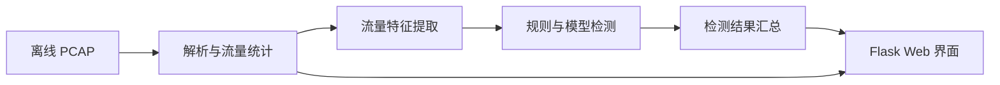

# 网络流量异常检测与智能分析系统

> 课程实训 · 双人项目 · Python / Scapy / Flask / 机器学习

## 项目简介

上传离线 PCAP 后，可以查看协议分布、流量统计和异常告警。项目基于 Pcap-Analyzer，把流量分析、机器学习检测和 Web 展示接到同一条流程里。告警用于辅助排查，不直接作为攻击结论。

## 实现流程

- **分析端**：使用 Python、Scapy 和 Flask，展示数据包、协议分布、流量统计和异常线索。
- **检测端**：原提交包包含 Random Forest、XGBoost、LightGBM、CatBoost、CNN、LSTM 六种模型产物，以及汇总检测结果的模块。
- **训练端**：使用 CICIDS2017，包含数据清洗、编码、归一化、数据集划分和训练集重采样代码。

## 实验结果

数据来自原提交包的 `ml_model_performance.csv`，为历史实验记录，未独立复跑。

| 模型 | 准确率 | 精确率 | 召回率 | F1 | 误报率 |
| --- | ---: | ---: | ---: | ---: | ---: |
| Random Forest | 99.31% | 73.90% | 66.60% | 69.53% | 0.29% |
| XGBoost | 99.71% | 88.70% | 80.69% | 81.96% | 0.09% |
| LightGBM | 84.26% | 33.06% | 18.18% | 20.95% | 5.95% |
| CatBoost | 99.37% | 81.50% | 71.43% | 74.28% | 0.23% |

XGBoost 在这四个模型中的 F1 最高。Random Forest 准确率超过 99%，但 F1 约为 70%，因此不能只看准确率。原预处理先归一化再划分，存在评估泄漏风险；复现时应仅在训练集拟合归一化器，并用独立流量验证。表格不含 CNN、LSTM 或融合策略的对照结果，不能据此判断融合是否优于单模型。

## 团队分工

两位成员共同完成 Web 层，分别负责前端展示和后端接口。具体分工如下：

- **沈如意**：负责系统整体架构、PCAP 数据解析、流量与协议分析，以及 Web 前端页面布局和图表渲染（HTML 模板、ECharts、D3）。
- **朱晨茜**：负责攻击检测模块、Flask 后端路由与接口，以及六种模型的训练和软投票集成。

## 项目来源

基础分析框架来自 [HatBoy/Pcap-Analyzer](https://github.com/HatBoy/Pcap-Analyzer)，原提交中的上游工程附有 GPL v3 许可文本。此页仅作项目展示，不包含源码、模型权重或原始抓包。
