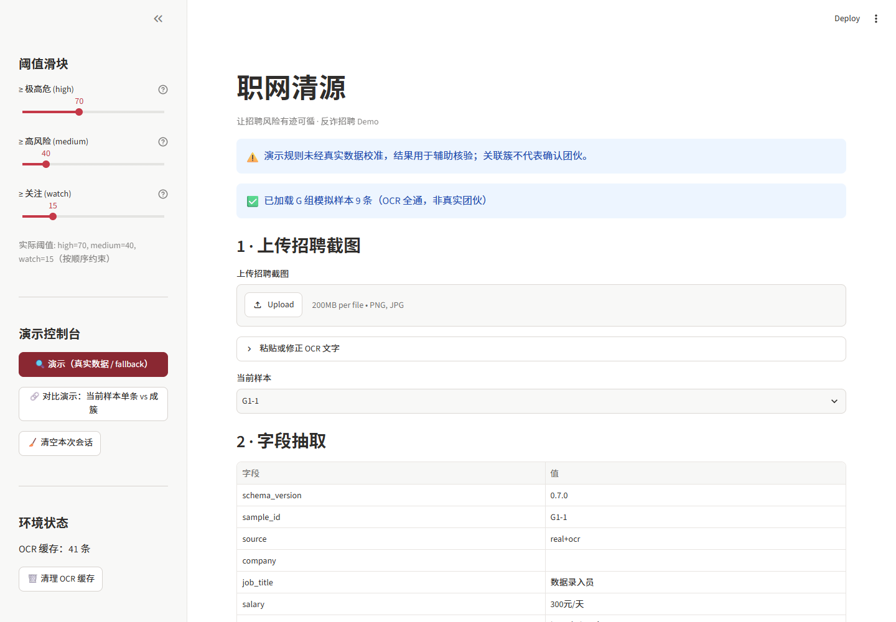
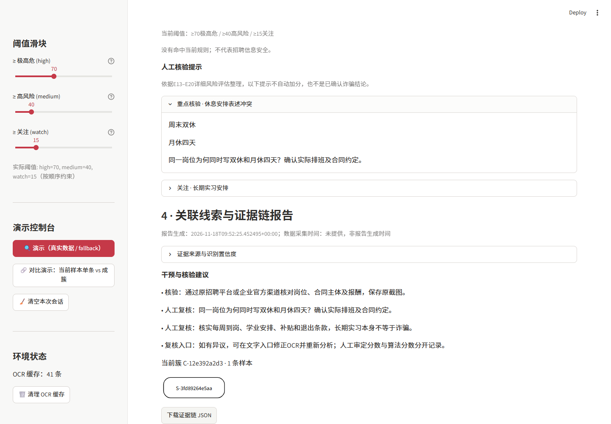

# 职网清源：招聘风险辅助初筛 Demo

> 挑战杯校赛阶段原型 · 持续完善中 · 2026-11 初步记录

本项目尝试把招聘截图转成可解释的风险线索，帮助使用者发现需要进一步核验的信息。输出用于辅助初筛，不对招聘主体或诈骗事实作确定性认定。

本目录是作品集记录，展示项目思路、本人参与范围、实现与验证过程；完整代码暂未在本目录公开。

## 项目背景与目标

招聘信息的风险线索可能分散在岗位描述、联系方式和相似文案中。校赛阶段先搭建可运行的最小闭环，便于团队联调和现场演示，再逐步改进算法与评测。

```text
截图上传 / 粘贴文字
        ↓
PaddleOCR 识别
        ↓
正则字段抽取
        ↓
六规则四档分级 + 人工核验提示
        ↓
共享联系方式 / 文本模板关联 → Union-Find 聚类
        ↓
证据展示与 JSON 报告
```

## 我的参与范围

我在团队中属于 A 组，负责字段抽取、风险规则及相关接口的对齐与联调。本阶段借助 AI 编程工具完成原型实现、测试与迭代，团队另行进行样本收集和人工复核。

- 对齐 `extract_fields()`、`classify()` 等接口，以 `dict` 为统一的数据传递单位。
- 整理字段正则、规则编号、权重、风险档位及证据原文。
- 推进 OCR、风险分级、关联聚类和 Streamlit 展示的集成。
- 结合团队人工复核意见排查误报、漏抽及样本映射问题。
- 检查演示结果与申报材料的一致性，记录当前局限。

## 已实现的原型功能

| 功能 | 当前实现 |
|---|---|
| 输入 | 上传截图、粘贴及修正识别文字 |
| OCR | PaddleOCR 真实推理，结果缓存与错误提示 |
| 字段抽取 | 公司、岗位、薪酬、地点和联系方式等，保留命中原文位置 |
| 风险分级 | R01–R06 规则，四档展示，记录实际阈值 |
| 人工核验提示 | 作息冲突、长期实习、外派、转编承诺、薪酬口径等待核验事项 |
| 关联线索 | 联系方式共用、原文/变量归一化模板 SimHash、Union-Find 连通簇 |
| 报告 | 算法结果、独立人工审定参考、证据列表、来源/时间及核验建议 |

收款账户抽取与共享账户关联是可选扩展，只用明确虚构的样本验证过逻辑，当前真实数据没有验证该维度效果。公司同名仅作已有关联的辅助证据。

## 演示截图

以下展示模拟样本与测试文本，不展示原始真实招聘截图。





## 技术栈与接口

- **Python 3.11 / Streamlit**：业务逻辑与交互界面。
- **PaddlePaddle / PaddleOCR**：截图文字识别，当前采用 PP-OCRv5 mobile CPU 配置。
- **正则表达式**：字段抽取与可解释规则。
- **SimHash / Union-Find**：候选文本关联与连通簇。
- **unittest / Streamlit AppTest / Playwright**：核心回归、界面交互与浏览器验证。

```python
fields = extract_fields({"text": ocr_text, "source": "paddleocr"})
risk = classify(fields)
clustering = gang_cluster({"samples": samples})
report = build_report({
    "fields": fields,
    "risk": risk,
    "clustering": clustering,
})
```

所有主业务接口接收并返回 `dict`。人工复核分数与算法分数分别记录，未将人工评分写成算法自动识别结果。

## 验证与迭代记录

目前本机完成 49 项回归、19 项自测、Streamlit AppTest，以及 Chrome 桌面/手机宽度的上传、展示和报告下载闭环验证。这些检查证明已覆盖的功能可运行，不等于真实业务准确率保证。

曾对 39 张图片运行真实 OCR，其中 E 组 20 张用于字段与风险评测，另有 10 个案例、9 条模拟样本。历史版本在该批数据上的字段严格匹配为 **47.5%（38/80）**，旧标签下四档一致率为 **65%（13/20）**。后续人工标签已复议，不能将这些历史指标直接称为新版最终成绩；样本也已用于调试，不是独立留出测试集。

九条模拟样本已按设计形成三个关联簇；该结果仅展示关联流程，不代表已经完成真实诈骗团伙识别。

本阶段重点排查过的问题包括：

- 同一编号匹配多张图片造成重复计数，改为拒绝歧义并显示评测覆盖率。
- 否定词影响范围过大，误过滤后续收费或高薪话术。
- 上传新样本后仍下载旧报告，以及报告更新与成功提示的时序问题。
- 图片已脱敏、岗位为摘要等数据口径与字段严格匹配的冲突。
- 将 OCR 置信度、规则权重和事实真实性混为一谈，改为分别记录、未知项留空。

## 当前边界与后续计划

**当前仍有边界：**规则分数不是校准后的诈骗概率；关联簇不是已确认团伙；未接入政企公示 API、涉诈名单或超图 GCN；复杂语义、图文矛盾和外部身份核验仍需人工介入。

后续计划：

- 统一标注口径，补充独立留出样本，分别评估 OCR、抽取和风险规则。
- 验证作息、薪酬等矛盾线索的误报率，改善真实网页的布局抽取。
- 在具备数据来源和权限后考虑接入外部公示信息，保留来源与核验时间。
- 将稳定版本整理为独立代码仓库，本目录保留项目索引和复盘。

## 公开范围

本目录仅包含项目说明和模拟演示图，不包含模型、虚拟环境、OCR 缓存、原始数据集、人工原始标注及未经确认可公开的团队材料。
